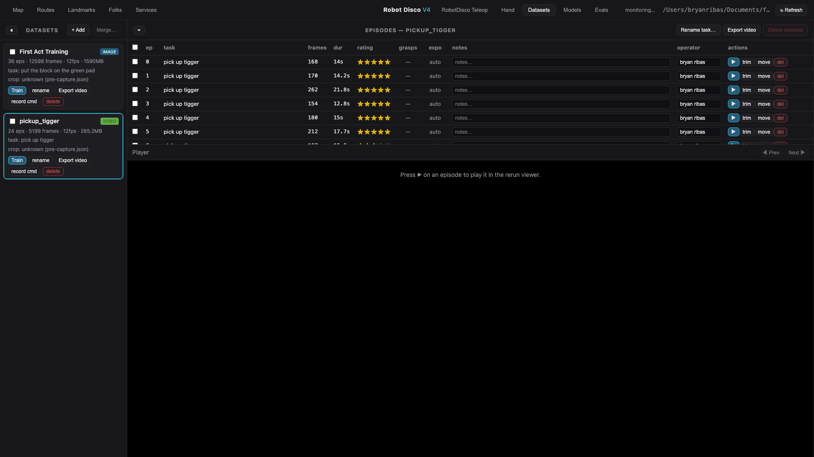
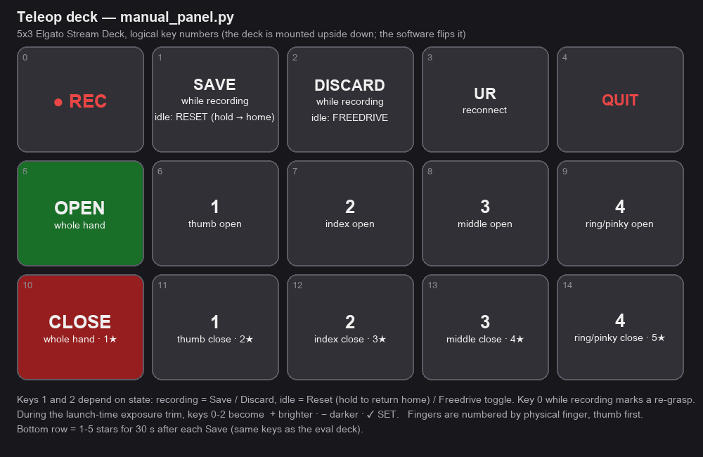

# VLA on UR5e with LeRobot

Vision-Language-Action policies on a Universal Robots UR5e with an AmazingHand end-effector, built on
[LeRobot](https://github.com/huggingface/lerobot) and mounted on the Robot Disco mobile base. The whole
loop runs on hardware: **RTDE** streams the arm for teleop and recording from a browser page on the robot PC
(a Jetson AGX Orin), **SmolVLA** is fine-tuned on the GPU box from the web manager's Train button, and the
checkpoint is served by an inference server **on the robot itself** (`vla_infer_server`, loopback), so
nothing real-time crosses the network. ROS 2 (the parent repo, `rd_ws`) drives the mobile base; a route's
waypoint can run a policy (`scripts/vla_action.py`), and the voice assistant does the same for a named
landmark ("Robot Disco, pick up tigger"). `scripts/pick_place_loop.py` chains grab → place → repeat.

This repo is the **`rd_ws/VLA` git submodule** (since 2026-11-02). On the robot it lives at
`~/rd_ws/VLA`; the GPU box keeps a plain copy at `~/VLA`.

The web manager (`webui/`, port 8081) is both the data console and the robot console, ten tabs:
Map (3D / 2D, live or simulated) · Routes · Landmarks (+ tasks) · Folks · Services · RobotDisco Teleop ·
Hand · Datasets · Models · Evals.

## Documentation

Full documentation lives in the **[project wiki](https://github.com/r1b4z01d/VLA/wiki)**:

- [Machines & Network](https://github.com/r1b4z01d/VLA/wiki/Machines-and-Network) — the three machines, the isolated robot subnet, where inference runs, `run.sh`.
- [Hardware Teleop & Recording](https://github.com/r1b4z01d/VLA/wiki/Hardware-Teleop-and-Recording) — the recording app and its browser page, the camera service and crop, Stream Deck, save / home / rating / upload.
- [Recording Sim Demos](https://github.com/r1b4z01d/VLA/wiki/Recording-Sim-Demos) — MuJoCo teleop capture and the sim grasp aid.
- [Training & Eval](https://github.com/r1b4z01d/VLA/wiki/Training-and-Eval) — fine-tune SmolVLA (what the Train button runs), train ACT, sim eval, playback, merge / recover.
- [Web Manager (RobotDisco)](https://github.com/r1b4z01d/VLA/wiki/Web-Manager) — the ten tabs, the CLI / env flags, Docker.
- [Deploy on Hardware](https://github.com/r1b4z01d/VLA/wiki/Deploy-on-Hardware) — run a policy on the real UR5e (`eval_hw.py`), unattended runs, stages, `vla_action.py`, the route runner and landmark tasks.
- [8-DOF Hand](https://github.com/r1b4z01d/VLA/wiki/8-DOF-Hand) — per-finger flex + abduct (in progress).
- [Sync & Layout](https://github.com/r1b4z01d/VLA/wiki/Sync-and-Layout) — how each machine gets the code, and the repo map.

See also **[ROADMAP.md](ROADMAP.md)** (what is built, in progress and next) and
**[docs/decisions.md](docs/decisions.md)** (the architectural choices as taken).

## License

[CC BY-NC-SA 4.0](LICENSE) for everything in this repo, including the `ur5e_amazinghand_bringup` ROS
package. LeRobot and the other dependencies keep their own licenses.
