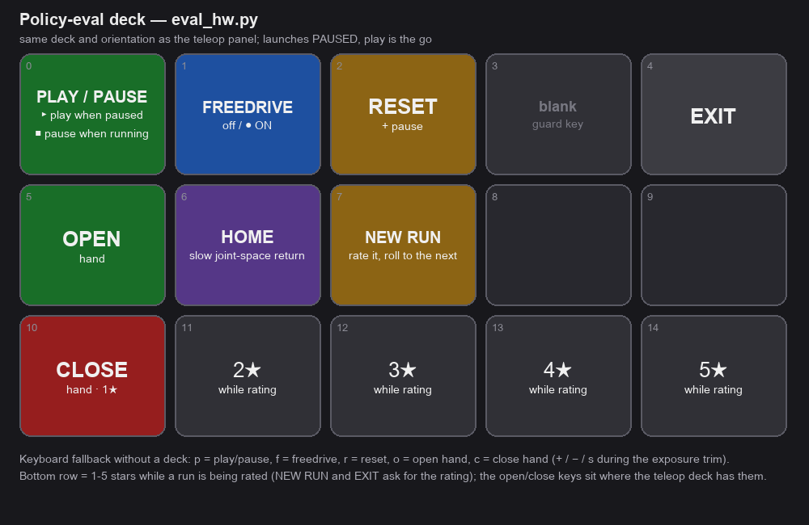

# Deploy a Trained Policy on Real Hardware (`eval_hw.py`)

> **e-stop in hand.** This is **motion-producing.**

Runs a trained checkpoint on the **real UR5e + AmazingHand** from live camera + proprioceptive
observations (`scripts/eval_hw.py`, on the robot PC). The same `rtde_arm` clamps stay active (workspace
no-go, per-step `max_step` + `max_rot_step`, IK-reachability guard), so the arm *ramps* toward the
policy's targets and can't jump; **Ctrl-C** aborts (stops the servo + control script).

## One-time offline setup
The robot subnet has no internet: the ACT ResNet18 backbone tries to fetch ImageNet weights the first
time a checkpoint loads. Seed the torch cache once — copy `resnet18-f37072fd.pth` into
`~/.cache/torch/hub/checkpoints/` from a machine that has it (the GPU box or Mac) — and `run.sh` already
exports `HF_HUB_OFFLINE=1`. The trained weights overwrite the backbone on load, so the ImageNet init is
only needed to build the module.

## Interactive — Stream Deck / browser page / keyboard, launches PAUSED
No panel-first dance: the eval powers the UR up, enables the **tool voltage** for the hand, meters and
locks the camera **exposure** (`--expose-manual` to trim on the deck, `--no-expose` to skip), applies the
**crop the checkpoint was trained with** (from the served `capture` info; `--scene-square` / `--side-square`
override) and starts PAUSED. The deck, the keyboard and the browser page send the same events:

- **PLAY / PAUSE** (`p`) — toggle the policy. Paused holds the arm; play (re)starts and resets the
  policy so it re-observes from the current pose. Key is **green** paused, **red** while the arm is live.
- **FREEDRIVE** (`f`) — gravity-comp teach mode: hand-guide the arm to a **training** start pose (policy
  suspended). Pressing PLAY exits freedrive and starts.
- **RESET** (`r`) — reset the policy's internal state and pause (arm holds). Abort a run and start clean.
- **HOME** (`h`) — press-and-go slow joint-space return to the captured home pose (second press cancels).
- **✊ CLOSE hand** (`c`; deck row 3 first key, the same place and icon as the teleop panel's; the
  stars borrow that key while a run is being rated) — close all four fingers by hand, e.g. to re-seat an object
  before PLAY or to carry it; pauses the policy first so the close is not overwritten.
- **🖐 OPEN hand** (`o`; deck row 2 first key, as on the panel) — release the grasp (also done automatically at NEW RUN / RESET, so every run
  starts from the open-hand condition the demos have).
- **NEW RUN** (`n`) — finish this run, rate it `1-5`, and roll to a fresh run directory without
  restarting; the deck bottom row and the page's stars both rate.
- **EXIT** (`x`) — stop + disconnect cleanly (Ctrl-C also aborts).

Every run lands in `outputs/eval_runs/<timestamp>_<task>_rNN/` with `steps.csv`, the rollout video
(`rollout.mp4` with `--video`) and a registry-format `eval.json` (resolved checkpoint, model key, served
flags, exposure, crop, rating, and with `--landmark <name>` the place the run was done at), and is pushed
to the GPU box's `outputs/evals/` (`--gpu-host bryan@GPU`, `--gpu-evals-dir ~/VLA/outputs/evals`) so it
appears in the manager's **Evals** tab, grouped by model with a combined rating.

Other `eval_hw.py` flags: `--ik-mode dls|servoL` (default `dls`), `--n-action-steps` / `--temporal-ensemble`
(local ACT only; for `--remote` the server's flags apply), `--operator`, `--run-dir` / `--log-csv` /
`--video-out` (override the run directory layout), `--obs-warn-ms` (log slow observations), `--log-every`,
`--hand-transport udp|tcp`, `--tool-voltage` (12 V default, powers the hand's ESP32), `--no-ur-power`,
`--ur-shutdown` (power the UR down at exit), `--ui web|none`, `--web-port` (8090).



## Run (e-stop in hand)
UR pendant in **Remote Control**; place the target as in the demos. The normal way is the manual-start
supervisor unit `vla_eval` on RD (`scripts/service_eval.sh`, arguments in `~/rd_ws/VLA/config/eval.env`: task,
`--remote`, fps, video, crop overrides). The eval's **preflight** stops the recording panel if it is up
and brings `vla_infer_server` up, then the run starts; `stop` is the eval's EXIT (run closed and uploaded,
UR powered down):
```bash
sudo supervisorctl start vla_eval        # or from the supervisor web UI, http://192.168.11.80:9999/
```
By hand, the same thing is SmolVLA served by the robot's own inference server:
```bash
sudo supervisorctl start vla_infer_server          # serves outputs/serve_ckpt on 127.0.0.1:8777
~/rd_ws/VLA/run.sh scripts/eval_hw.py --remote 127.0.0.1:8777 --cameras udp \
  --task "place tigger in the banana bed" --fps 12 --video
```
A local ACT checkpoint still works without a server:
```bash
~/rd_ws/VLA/run.sh scripts/eval_hw.py \
  --ckpt outputs/train/hw_pickplace_act/checkpoints/last/pretrained_model \
  --task "pick up the Home Depot bucket" --temporal-ensemble 0.01 --fps 12 --video
```

## Preflight: what every eval launch checks first
`vla_teleop` (the recording panel) and `vla_eval` cannot run together — both own the SpaceMouse, the
Stream Deck, page port 8090 and the UR control script — and the ROS UR driver loads its own program onto
the same controller. So every eval launch (the unit, by hand, a route action) runs a preflight
(`ur5e_lerobot/services.py`): it **stops `vla_teleop` and `robot_disco_ur5e_driver` if they run** (their
clean shutdown, up to a minute), and for a loopback `--remote` **makes sure `vla_infer_server` answers**,
starting it if needed (`--no-auto-infer` only verifies, `--no-preflight` skips; exit code 4 on failure).
The panel does the mirror image (stops `vla_eval`). By hand:
```bash
~/rd_ws/VLA/run.sh -m ur5e_lerobot.services status                       # units, server port, what is served
~/rd_ws/VLA/run.sh -m ur5e_lerobot.services serve tigger_bed_1_smolvla   # switch the model: repoint serve_ckpt + restart
~/rd_ws/VLA/run.sh -m ur5e_lerobot.services info
```
`serve` takes a run name (its `checkpoints/last`), `run@020000`, or a checkpoint path, and is a no-op
when the running server already reports that checkpoint.

## Unattended runs (`--auto`) and the route runner
`scripts/eval_hw.py --auto` runs without an operator: it PLAYs as soon as it is READY, stops on
`--steps`, `--max-seconds` (default 120) or `--still N` (N seconds in which nothing was commanded to
move: per-step command deltas under 1.5 mm, 0.8° and 0.02 curl, checked only after `--min-seconds`),
opens the hand unless `--keep-grasp`, returns to the home pose unless `--no-home`, and exits: **0** done,
**3** aborted on a UR fault (protective stop / e-stop: the controller is reconnected, no further motion),
**4** preflight failure. With `--keep-grasp` the UR also stays **powered** at exit so the tool voltage
keeps the hand's servos holding what they carry (the hand firmware keeps its last setpoint; there is no
link watchdog). `--result-file` writes the outcome as JSON for the caller, and the run's `eval.json`
carries `auto.stop` with the reason. `--still-mode fingers` judges the end by the **grasp** instead of
the arm: the countdown only arms once the commanded curls have moved by 0.3 from the run's first action
(the grasp or the release happened) and then runs while no finger moves, whatever the arm does.
`--wait-go` launches PAUSED and takes PLAY (deck / page / `p`) as the go; EXIT before the go is exit
code **5**. `--leave-powered` skips the UR power-down between back-to-back stages. The hand's last
commanded curls are written to `outputs/hand_state.json` at exit; a stage that starts after a
`--keep-grasp` exit re-sends them, so the place model observes the closed hand it expects.

**End by the grasp level** — `--done-when closed|open` judges the end by what the hand is doing, not
by motion: `closed` once the mean commanded curl has averaged ≥ 0.7 over the last `--still` seconds
(a grab: the hand closed and stays closed), `open` once it averages ≤ 0.2 after the hand has been
closed (a place: the release happened). Measured on the grab model (2026-10-26): curl commands jitter
up to 0.25 per step while holding and the policy re-grasps repeatedly, so a motion test only settled
after 36 s; the level test fires about 2 s after the first close.

**Stages: grab → place → repeat in ONE eval process** — `--stage "name=grab model=<run> task='…'
done=closed keep=1" --stage "name=place model=<run> task='…' done=open" --cycles N` (0 = until EXIT).
The cameras, exposure, UR and hand connect once; for each stage the eval switches the server's model,
applies that model's crop, and waits for **PLAY** as the go (the deck's top-left key reads `GO ▶ grab`,
the page shows it); the run ends by its `done=` test, the grasp is kept or the hand opened, the arm goes
home, and the next stage is prepared. **RESET** while a stage waits redoes the previous stage; **EXIT**
quits. Each stage is its own run in the registry. `scripts/pick_place_loop.py` is the wrapper with the
route's models as defaults:
```bash
~/rd_ws/VLA/run.sh scripts/pick_place_loop.py            # grab (tigger_1_merged_smolvla_1) -> place (tigger_bed_1_smolvla) -> repeat
~/rd_ws/VLA/run.sh scripts/pick_place_loop.py --dry-run  # just the command
```

**Resident models** — `vla_infer_server` keeps several checkpoints loaded (`--also <run>` in
`services/rd/vla_infer_server.conf`; the route's two models are listed, ~1 GB each on the 64 GB Orin)
and switches between them on `{'cmd':'select'}` in well under a second: a policy reset, no restart.
`services serve <run>` and the stages use that path whenever the model is resident and fall back to the
repoint-and-restart (~16 s) when it is not; `services status` lists the resident set.


`scripts/vla_action.py --model <run> --task "…"` wraps one such run as a single command: preflight (also
stops `vla_eval`), switch the server to the model (only restarts when it serves something else), run
`eval_hw.py --auto`, return the eval's exit code. Its flags map onto the `--auto` options above:
`--seconds` (wall-clock cap, default 120), `--min-seconds`, `--still N`, `--still-mode all|fingers`,
`--done-when closed|open`, `--steps`, `--keep-grasp`, `--no-home`, `--leave-powered`, `--wait-go`,
`--landmark <name>` (recorded on the run's `eval.json`), `--web-port`, `--extra "…"` (anything else,
passed through to `eval_hw.py`), `--dry-run` (print the command). `scripts/pick_place_loop.py` is the
two-stage wrapper with the route's models as defaults: `--pick-model` / `--pick-task`, `--place-model` /
`--place-task`, `--still 2`, `--min-seconds 3`, `--seconds`, `--cycles 0` (until EXIT), `--no-video`,
`--extra`.

Three things call `vla_action.py`:
- the **route runner**: a `vla:` entry in a waypoint's `post_actions` (`rd_ws/Scripts/path.py`) stops the
  base at the waypoint, runs the action, and drives on when the arm is back home.
  `rd_ws/Scripts/tigger_route.yaml` is the fetch-and-carry example: bookshelf → pick up Tigger
  (`keep_grasp`) → banana bed → place → onward. `python3 path.py --check route.yaml` prints the segments
  and the exact commands without ROS;
- a **landmark task** from the manager's Landmarks tab ([Web Manager](Web-Manager#landmarks)): a named
  place on the map carries tasks (what you say, model, task string, the options above); ▶ Run hands
  `{landmark, task}` to the voice assistant, which drives there and runs the action;
- the **voice assistant** itself ("Robot Disco, pick up tigger"): the task's landmark says where to drive.

## Reactivity (important)
An ACT checkpoint runs `n_action_steps == chunk_size` (here 100) by default — **fully open-loop**: one
observation, then 100 blind actions (~8 s at 12 fps). For a contact-rich pick this alone can mean 0%.
`--temporal-ensemble 0.01` re-observes **every step** (ALOHA-style blending); `--n-action-steps 8`
re-observes every 8. Both are inference-time only — **no retraining**.

Typical loop: launch (paused) → **FREEDRIVE** to a training-like start → **FREEDRIVE off** → **PLAY** →
watch → **PAUSE** / reposition / **PLAY** → **EXIT**. `--fps` **must match the training data** (12 here);
`--device cpu` by default (ACT is small, CPU keeps up at 12 fps; the Jetson has CUDA if you want `--device cuda`); `--video`
writes `rollout.mp4` into the run directory (the played segments); `--steps N` auto-pauses after N played steps (0 =
unlimited); `--task` is cosmetic for ACT (no language encoder). There is **no automatic success metric**
on hardware — watch it and judge, or review the MP4. First rollouts from ~20 demos read as "reaches the
right region" more than clean grasps; the fix is more position-varied demos, not a bigger model.

SmolVLA always runs through the **remote-inference bridge** (`--remote`, `scripts/infer_server.py`), and
since the Jetson Orin replaced the robot PC (2026-10-10) that server runs **on the robot itself**:
`sudo supervisorctl start vla_infer_server` on RD, then `eval_hw.py --remote 127.0.0.1:8777 --cameras udp`.
Reactivity (`--n-action-steps`, `--prefetch`, `--rtc`) is set in `services/rd/vla_infer_server.conf`, not on
the client. Serving from the GPU box over the LAN (`--remote <GPU_IP>:8777`) is the fallback — see
[Machines & Network](Machines-and-Network#where-inference-runs-since-the-jetson).

## Browser page for the eval (`--ui web`, default)
`eval_hw.py` serves the same page as the teleop panel in eval mode on port 8090: ▶ PLAY / PAUSE,
FREEDRIVE, RESET, ⌂ HOME, NEW RUN, 🖐 open, ✊ close, EXIT and the 1-5 rating all map to the Stream Deck's
key events, so the deck, the keyboard and the page are interchangeable. The cards are Exposure, Model (the
served checkpoint, reactivity flags and crop), Run (steps, step/inference timing, the stars), Runs this
session and Arm; every console line also lands in the page's log. `--ui none` disables it. The manager's
**RobotDisco Teleop** tab embeds this page whenever `vla_eval` is up.

<!-- TODO screenshot: robot-page-eval.png — http://192.168.11.80:8090/ in eval mode (robot only, not yet captured) -->
