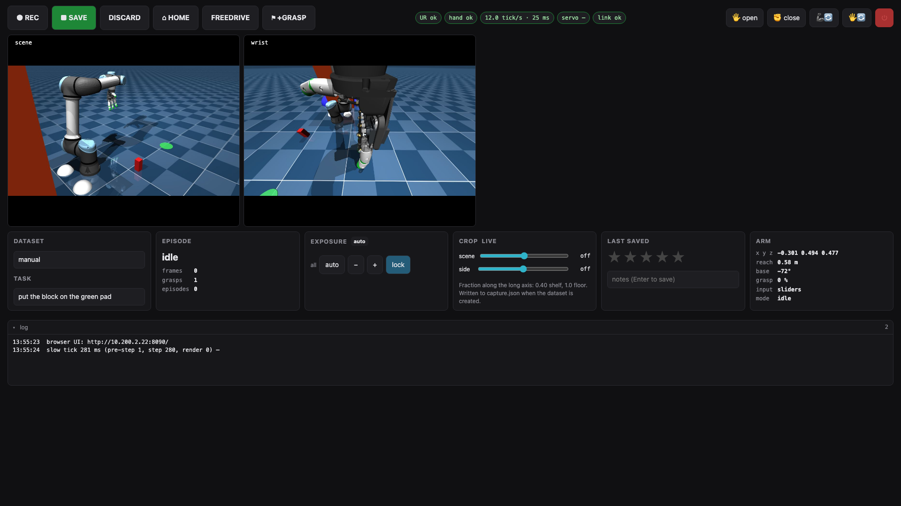
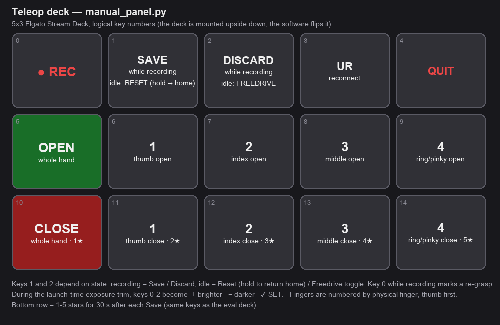

# Hardware Teleop & Recording

Runs **on the robot PC** (the Jetson Orin, `rd@192.168.11.80`; the SpaceMouse/gamepad, Stream Deck and
cameras need its local USB seat). The UI is a **browser page** served by the panel itself (port 8090),
so you operate from the Mac, a tablet next to the robot, or RD's own screen — see
[Browser page](#browser-page---ui-web-default) below. The classic Tk window is still there behind `--ui tk`.

**Arm over RTDE** (`robot/rtde_arm.py`): the panel hands a Cartesian target to a **servo streaming
thread** every tick; that thread asks the controller for **one IK solution per hand-over**, interpolates
in joint space and re-sends `servoJ` at **50 Hz** with a 20 ms servo time, so the controller always has
a moving target (this is what cured the stutter: before, each 83 ms `servoL` window expired before the
next command arrived). Software guards stay in the command path: workspace **no-go** clamp (TCP and
elbow/wrist links via FK), per-command `max_step` / `max_rot_step`, the **z-floor** from the workspace
calibration, and the IK-reachability check (an over-reach holds instead of faulting the controller).
**Hand over UDP** (`hand/amazing_hand_client.py` → `.117:8766`, fire-and-forget setpoints with a
liveness probe; the Wi-Fi link loses 12-25 % of packets and TCP used to replay stale setpoints seconds
late; `--hand-transport tcp` is the legacy path). `ur_power.py` powers the UR up over the dashboard at
launch, clears a protective stop and restarts the safety system after a fault, and parks the arm on exit.

> **Safety note.** The clamps are **software guards in the servo command path only** — not a substitute
> for UR **safety planes / limits** in PolyScope. They are **bypassed in freedrive** (teach mode is
> UR-controlled). Keep the e-stop in hand. The installation's Normal-mode **tool speed limit** applies
> to hand-guiding too: a 250 mm/s limit trips a violation at a brisk hand movement, and pushing the arm
> while it is stopping escalates that to a fault with the arm powering off (seen 2026-10-24).

## Cameras
Three USB cameras owned by **one camera service** (`scripts/camera_server.py`, supervisor unit
`vla_cameras` on RD, autostart): it grabs 1280×720 MJPG at 15 fps, applies the per-camera rotation and
square crop, and publishes JPEG over multicast; the panel, the eval, the ROS bridge and any browser
subscribe at once. **`--cameras udp` is what every robot launch needs** — the flag defaults to `local`
(open the USB devices in-process), which clashes with the always-on service; the service wrappers
(`vla_teleop`, `vla_eval`) pass `udp` for you. Useful URLs on RD:

- `http://192.168.11.80:5602/` — index with all feeds; `/<cam>.mjpg` stream, `/<cam>.jpg` one frame,
  `/<cam>.raw.jpg` the **full upright frame with the crop square drawn**.
- `scripts/camera_viewer.py --host 192.168.11.80 --squares` / `--square scene 0.65` — read / move the
  crop live (not persisted; the constants in `sensors/cameras.py` are the service defaults).

Cameras are addressed by **USB-port `by-path`** (same model, no serial; the Jetson port map is in
[camera_setup](https://github.com/r1b4z01d/VLA/blob/main/docs/camera_setup.md)). **scene** and **side**
are mounted sideways, so after rotation they are 720×1280 portrait and a **square crop** selects the
720×720 window: `at` = 0.40 keeps rows 224-944 (shelf), 1.0 the bottom 720 rows (floor). The crop is
part of the observation geometry: it is recorded in the dataset (`meta/capture.json`, shown on the
manager's dataset card), carried into the checkpoint by training, reported by the inference server and
applied by the eval. Pick it with the raw view before recording and pass it on the **first** launch of
a root (`--scene-square 0.65 --side-square 0.60`); a resumed root re-applies its own. Datasets with
different crops cannot be merged. The wrist camera is landscape and uncropped. A dataset recorded
**before** this file existed can be given one after the fact with `scripts/capture_backfill.py --root
<dataset> --scene <at|none> --side <at|none> --run outputs/train/<run>` (`none` = the fit-and-pad,
pillarboxed portrait; done 2026-10-26 for `OLD - pickup_tigger` (none/none) and `tigger_1` /
`tigger_1_merged` (0.5/0.5), with the result shipped into their run directories on RD). In UDP mode
the side camera is recorded automatically when the service publishes it; `--side-cam` only matters
for local cameras. If a camera drops off USB the service re-opens it by itself, and a launch that
finds no frames restarts the service once and retries.

Exposure is **metered at launch and locked** (auto → lock; `--expose-manual` opens the deck trim keys);
the locked values are written with each episode's annotation. To pick exposure by number instead of
by eye, `scripts/tune_exposure.py` sweeps values and reports clip % / mean / p1 / p99 on the frame as
recorded (rotation and crop applied), checks the camera honours the control, and writes a PNG per
value; the winners go into `cameras.py`.

## Starting it as a service (normal way since 2026-10-26)
The panel is a **manual-start supervisor unit** on RD, `vla_teleop` (`services/rd/vla_teleop.conf` →
`scripts/service_teleop.sh`). Its arguments live in `~/rd_ws/VLA/config/teleop.env` (dataset root, repo
id, task, crop for a new root, operator, `EXTRA_ARGS`; created from `services/rd/teleop.env.example`
by `scripts/install_services.sh rd`, never overwritten). Edit the file, then start the unit from the
manager's **Services** tab, the supervisor web UI (`http://192.168.11.80:9999/`) or on RD:
```bash
sudo supervisorctl start vla_teleop      # stop: supervisorctl stop vla_teleop = the panel's clean Quit
```
The wrapper first **takes over port 8090** from a stale panel or eval (SIGTERM, then kill after 20 s;
anything else on the port is left alone) and runs `ur5e_lerobot.services teleop-preflight`, which
stops `vla_eval` and the ROS UR driver — the SpaceMouse, Stream Deck, UR control script and port 8090
are exclusive, so `vla_teleop` and `vla_eval` cannot run together. Then it execs
`manual_panel --engine hardware --cameras udp --ui web --root … --repo_id … --task … [--resume]
[--scene-square …] [--side-square …] [--operator …]`. `stop` sends SIGTERM, which the panel turns into
its normal shutdown (open episode dropped, dataset finalized, UR powered down). Logs:
`~/rd_ws/VLA/log/vla_teleop.out.log` and `log/manual_panel.log`. The unit carries the X display of rd's
autologin session (Tk schedules the loop even in web mode). Running the panel by hand from a terminal
still works for development.

## Bring-up (e-stop in hand)
1. UR pendant → **Remote Control**. The panel powers the arm on and releases the brakes itself.
2. The hand is powered from the **UR tool port** (`--tool-voltage 12`); the panel enables the tool
   voltage and power-cycles it if the first connect fails.
3. Launch (a fresh `--root` starts a new dataset; `--resume` appends; video storage and the SpaceMouse
   are the defaults):
   ```bash
   ~/rd_ws/VLA/run.sh -m ur5e_lerobot.teleop.manual_panel --engine hardware --cameras udp \
     --root outputs/datasets/tigger_bed_1 --repo_id local/tigger_bed_1 \
     --task "place tigger in the banana bed" --scene-square 0.75 --side-square 0.75
   ```
   It prints `[web] open http://192.168.11.80:8090/` — open that, or the manager's **RobotDisco Teleop**
   tab. Everything printed also lands in `~/rd_ws/VLA/log/manual_panel.log`.
4. Before a new task, run the **workspace calibration** once (`scripts/calibrate_workspace.py`): it
   powers the arm up, enters freedrive, captures floor / teleop-box / no-go points, survives protective
   stops (ENTER clears and resumes) and writes `outputs/workspace_calib.json`, which the panel and the
   arm clamps load automatically.

### Panel flags worth knowing
| flag | default | |
|---|---|---|
| `--engine hardware\|mujoco\|kinematic` | `mujoco` | the real arm, the MuJoCo sim, or a fast kinematic sim |
| `--input spacemouse\|gamepad\|freedrive\|sliders` | `spacemouse` | action source |
| `--cameras local\|udp`, `--camera-host` | `local` | **use `udp` on the robot** |
| `--fps`, `--width`, `--height` | 12, 960, 540 | record rate and the capture box |
| `--use-videos` / `--png` | video | storage type, fixed when the root is created |
| `--grasp pinch\|full` | `pinch` | thumb + pointer, or the whole hand, on the grasp button |
| `--scene-square`, `--side-square` | from `cameras.py` | the crop for a NEW root |
| `--hand-host`, `--hand-transport udp\|tcp` | `192.168.11.117`, `udp` | |
| `--tool-voltage 0\|12\|24`, `--no-ur-power`, `--ur-shutdown` | 12 | tool power, dashboard power-up/down, controller shutdown on quit |
| `--gpu-host`, `--gpu-datasets-dir`, `--no-gpu-sync` | `bryan@GPU`, `~/VLA/outputs/datasets` (the GPU box's tree) | the auto-upload |
| `--no-home-on-save`, `--expose-manual`, `--operator` | | |
| `--ui web\|tk\|both`, `--web-port` | `web`, 8090 | |
| `--selftest` | | headless logic check, no GUI |

## Browser page (`--ui web`, default)
One page, two modes (teleop here, eval on [Deploy on Hardware](Deploy-on-Hardware)). It is a view plus
a command channel: state arrives as Server-Sent Events, buttons POST commands that the control loop
drains once per tick exactly like the Stream Deck's keys — the loop, the input devices and the deck are
unchanged, and the camera tiles stream straight from the camera service.


<!-- TODO screenshot: robot-page-teleop-hw.png — http://192.168.11.80:8090/ with vla_teleop running on the real arm (robot only, not yet captured) -->

- **Action row** — ● REC, ■ SAVE, DISCARD, ⌂ HOME (press-and-go return to the captured home), FREEDRIVE,
  ⚑ +GRASP (mark a re-grasp range), status pills (UR, hand, tick rate, servo stream, link), **🖐 open /
  ✊ close** (hold to ramp, same rate as the deck's finger keys), **🦾🔄** (reconnect the UR: clears a
  protective stop, reloads the control script), **🖐🔄** (recover the hand: power-cycle the tool,
  reconnect), **⏻ quit** (confirmed; an unsaved episode is dropped and the UR powered down).
- **Cameras** in one row when the screen is wide enough.
- **Cards** — Exposure (auto / − / + / lock), Crop (sliders, live until the dataset is created), Episode
  (frames, grasps, episodes this session), Last saved (★ rating, notes), **Dataset / Task** (switch the
  recording root by name — an existing dataset appends, a new name is created on its first save; edit the
  task string), Arm (pose, reach, base angle).
- A **fault banner** with the decoded UR code (from the controller's own event stream) and a **Recover** button.
- Keyboard: `r` rec, `s` save, `d` discard, `h` home, `f` freedrive, `g` grasp mark, `o`/`c` open/close, `1-5` rate.

`--ui tk` shows the classic Tk window instead, `--ui both` shows both; only one robot app can serve port
8090 at a time (`--web-port`). Inputs: `--input spacemouse` (default) · `gamepad` (Xbox, evdev) ·
`freedrive` (hand-guide; grasp via keys/SpaceMouse buttons) · `sliders`. Calibrate the axes once with
`sm_calibrate` / `gp_calibrate` (writes `outputs/{sm,gp}_calib.json`).

**Home pose:** the **🏠 Set Home** button exists only in the Tk window — launch once with `--ui tk` (or
`both`), freedrive to a comfortable start pose and click it: it captures the joint config to
`outputs/home_pose.json` (loaded on launch; the face node's wave and the eval read the same file).
The deck **Reset** key hold-returns to it, the page's ⌂ HOME is press-and-go (slow joint-space
`servoJ`, singularity-safe). Make it a safe **transport pose** (arm tucked, object clear).

## Save, home, rating, upload
Pressing **Save** closes the episode at once: the arm starts its **return to home** (not recorded — the
demos end at the grasp; the retract is rig housekeeping), the **rating** lights up immediately (deck
bottom row `1★-5★` for 30 s, and the page's stars any time), and the dataset save (image writer drain,
video encode, stats, parquet, a finalize/re-open so the on-disk copy is loadable) runs on a background
thread. The GPU **upload** (`rsync` to `--gpu-host`, `--no-gpu-sync` disables) starts when that thread
finishes and runs in parallel with homing and rating; a rating or notes trigger another sync. A new REC
waits for an in-flight save. Ratings, notes, operator, grasps, re-grasp ranges and the locked exposure
live in `meta/annotations.json`, the sidecar the [Web Manager](Web-Manager) reads. `--no-home-on-save`
disables the return; it is also skipped when no home is set.

Storage is **video** by default (`--png` opts out): a 20 s episode is ~13 MB as video against ~374 MB as
PNG frames, and every dataset so far is video. The storage type is fixed when a root is **created**; a
resumed root keeps its own and the panel warns if the flag disagrees. LeRobot leaves a full Arrow copy of
the dataset in `~/.cache/huggingface/datasets` on every save; the panel prunes that cache after each save
(it filled RD's disk once).

## Stream Deck
Optional (`teleop/streamdeck.py`; the deck is mounted upside down, so the labels and key indices are
flipped in software). 5×3 keys, logical numbering:

- **Row 1 — actions.** Key 0 is **● REC** (red; while recording it marks a re-grasp range, start/end,
  the count on the key). Keys 1 and 2 are **state-dependent**: while recording **Save** / **Discard**;
  between episodes **Reset** (hold → slow return to Home) / **Freedrive** (toggle teach mode to
  reposition). Key 3 **⟳** reconnects the UR, key 4 **✖** quits the panel. With `--expose-manual`, keys
  0-2 become **+ brighter / − darker / ✓ SET** during the launch-time exposure trim.
- **Row 2 — open, row 3 — close.** The first column is the **whole hand** (🖐 / ✊), then fingers
  **1-4 numbered by physical finger, thumb first**: 1 thumb · 2 index · 3 middle · 4 ring/pinky
  (the keys remap number → curl channel, so a key does what its label says despite the hand's channel
  order). Hold to ramp.
- **Bottom row = `1★-5★`** for 30 s after each Save. ● REC blinks red while recording; Save flashes
  green on save.



## When the arm stops
A protective stop ends the control script; the page shows the controller's code in the fault banner and
**🦾🔄** (or the banner's Recover / the Tk Reconnect button) clears it and reconnects.
`scripts/ur_event_log.py` is a read-only listener on the controller's primary interface that writes
every C-code, popup and safety-mode change with the TCP pose to `log/ur_events.log` — run it when
something "just faults" and you want the reason. Common ones seen here: **C150A0** base joint pushed to
its ±360° limit (unwind the base before heading for the floor), **C283A51** tool moved faster than the
safety tool-speed limit while hand-guiding, **C306A1** a joint could not stop in time because a hand
kept pushing (arm powers off; the panel's power-up restarts the safety system).

## Replay / review a capture
Writes a montage (1 frame/episode) + a scene|wrist MP4. Headless (reads the recorded frames; no robot
needed), so it runs over SSH:
```bash
~/rd_ws/VLA/run.sh -m ur5e_lerobot.sim.playback --root outputs/datasets/<dir> \
  --montage outputs/playback/<name>.png --video outputs/playback/<name>.mp4 --fps 12
```
`--fps 12` plays hardware recordings at real time (raise to fast-forward); `--step N` subsamples;
`--montage`/`--video` are independent. Files land in `outputs/playback/` — open on the robot PC's
desktop or copy off with `scp`. The manager's episode player (rerun) does the same in the browser.
