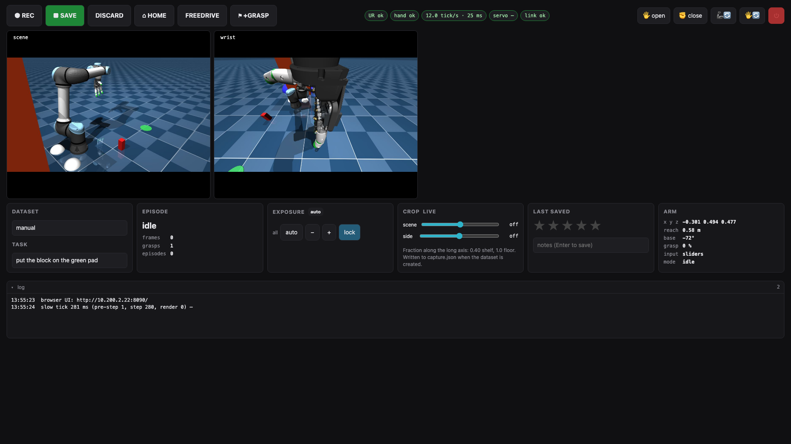

# Recording Sim Demos (teleop)

Drive the UR5e + AmazingHand in sim (MuJoCo) and record LeRobot datasets. **Prefer the GPU box** — it
records a *video* dataset where you train (image datasets load far slower). Run on the box's own desktop;
`MUJOCO_GL=egl` renders headless on the 4090; video encoding needs system FFmpeg (present on the box).
```bash
cd ~/VLA && .venv/bin/python -m ur5e_lerobot.teleop.spacemouse         # confirm the SpaceMouse reads
cd ~/VLA && MUJOCO_GL=egl .venv/bin/python -m ur5e_lerobot.teleop.manual_panel \
  --engine mujoco --input spacemouse --ui tk --root outputs/datasets/teleop
```
Video is the default (`--png` records images instead); `--input sliders` drives from on-screen sliders;
`--resume` appends to an existing dataset. **`--ui tk` matters here:** the panel's default is `--ui web`,
which runs the browser page only and hides the Tk window, and the MuJoCo preview, the sliders and the
sim-only controls (**Randomize Box/Goal** and the **ROYGBIV** box-colour dropdown) are Tk widgets, so use
`--ui tk` or `--ui both`. On the Mac, images only, and quit the 3Dconnexion 3DxWare driver first so the raw
SpaceMouse is readable.

The web-only route is `rd_ws/Scripts/dev_stack.sh start`: it launches the panel with
`--engine mujoco --input sliders --ui web` on `:8090` (the simulated scene and wrist cameras in the page),
the simulated route editor on `:8094` and the manager on `:8081`, so the whole GUI runs on a laptop with no
robot and no Tk window — good for the manager's Teleop tab, not for recording with a SpaceMouse.



## Grasping & scene
The AmazingHand can't form a stable *physics* grasp in sim (4-finger geometry won't oppose), so a
**grasp aid welds the block to the hand on close and releases on open** — pick-place "just works" for
demo collection (`build_combined_model(grasp_aid=False)` to disable). Block = 4×4×9 cm on the floor →
green pad. Collect *position variety*; a fixed position overfits (see
[Training & Eval](Training-and-Eval)).
