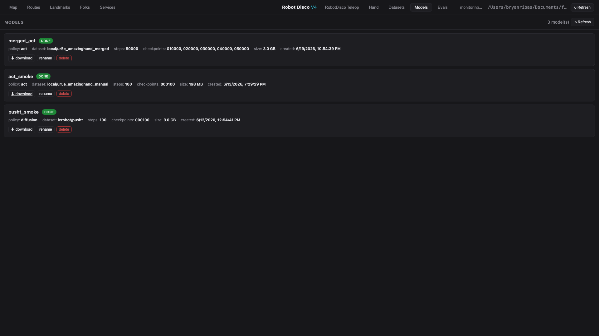

# Training · Eval · Playback · Merge

On the GPU box (`HF_HUB_OFFLINE=1` for local datasets; `PYTHONPATH=.` for the scripts).

## Fine-tune SmolVLA (the normal path)
The manager's **Train** button (Datasets tab → a dataset card → Train) runs `scripts/train_regrasp.py`,
a wrapper around `lerobot_train` that:
- starts from the pretrained base with `--policy.path=lerobot/smolvla_base` (**not** `--policy.type=smolvla`,
  which trains from scratch);
- builds `--rename_map` from the dataset's actual image keys (scene/wrist/side → camera1/2/3);
- oversamples the re-grasp segments marked in `meta/annotations.json` with an **adaptive weight**: 3 when
  the re-grasp share of the data is under 10 %, 2 under 20 %, else 1 (`webui/models.py`);
- copies the dataset's `meta/capture.json` (the crop) into `outputs/train/<run>/capture.json`, so the eval
  applies the crop the model was trained with;
- prunes the HF `datasets` Arrow cache first (`hf_cache.py`, keep the 3 newest);
- runs with `num_workers=4` (8 filled host RAM), `save_freq` 2500, and launches under
  `systemd-run --user` with `MemoryMax=40G`, `MemorySwapMax=4G`, `OOMPolicy=stop` when a user bus is
  available (from the supervisor-spawned manager it is not, and the run falls back to a plain subprocess).
The dialog also offers **ACT (from scratch)** and lets you set steps, batch size and save_freq. The same
thing by hand:
```bash
PYTHONPATH=. HF_HUB_OFFLINE=1 .venv/bin/python scripts/train_regrasp.py --regrasp-weight 3 \
  --policy.path=lerobot/smolvla_base \
  --dataset.repo_id=local/<id> --dataset.root=outputs/datasets/<dir> \
  --rename_map='{"observation.images.scene":"observation.images.camera1","observation.images.wrist":"observation.images.camera2","observation.images.side":"observation.images.camera3"}' \
  --batch_size=64 --steps=20000 --num_workers=4 --save_freq=2500 --policy.device=cuda \
  --policy.push_to_hub=false --output_dir=outputs/train/<run>_smolvla --wandb.enable=false
# then ship the checkpoint to the robot and point outputs/serve_ckpt at it (Machines & Network).
# eval_hw.py auto-detects act vs smolvla from the checkpoint config — same deploy command.
```
The Models tab shows the run with live step / loss / rate / ETA while it trains.



## Train ACT, sim eval, playback, merge
```bash
# Train ACT (no gym env -> eval_freq=0; no hub push):
HF_HUB_OFFLINE=1 .venv/bin/python -m lerobot.scripts.lerobot_train \
  --dataset.repo_id=local/<id> --dataset.root=outputs/datasets/<dir> \
  --policy.type=act --policy.device=cuda --policy.push_to_hub=false \
  --steps=50000 --batch_size=16 --num_workers=24 --eval_freq=0 \
  --output_dir=outputs/train/<run> --wandb.enable=false

# Roll out a policy in sim, score pick-place (+ --video):
PYTHONPATH=. HF_HUB_OFFLINE=1 .venv/bin/python scripts/eval_policy.py \
  --ckpt outputs/train/<run>/checkpoints/last/pretrained_model --episodes 10 --steps 400 --device cuda [--randomize] [--video]

# Replay recorded episodes (montage + video):
PYTHONPATH=. .venv/bin/python -m ur5e_lerobot.sim.playback --root outputs/datasets/<dir> --montage out/montage.png --video out/demos.mp4

# Merge/recover recording sessions into one dataset (handles unfinalized/partly-corrupt sources):
PYTHONPATH=. .venv/bin/python scripts/recover_merge_datasets.py \
  outputs/datasets/a outputs/datasets/b --out outputs/datasets/merged --repo-id local/merged
```
The manager's **Merge…** (select two or more dataset cards) does the same through `webui/ops.py`, but it
does **not** carry `meta/capture.json` into the merged dataset and does not check that the crops match:
the merged card reads "crop: unknown" until `scripts/capture_backfill.py` writes one. Only merge datasets
recorded with the same crop.

## Diagnostics
- `scripts/debug_eval.py` — replay a dataset's observations through a checkpoint and compare the predicted
  actions with the recorded ones; the gate before a hardware eval.
- `scripts/train_nostate.py`, `scripts/make_delta_dataset.py`, `scripts/run_delta_pipeline.sh` — the
  no-state and delta-action experiments.
- `scripts/merge_datasets.py`, `scripts/split_episode.py`, `scripts/to_video.py` — dataset surgery
  (the manager's trim / move / Export video use the same code).

> **Camera / dataset note.** `eval_policy.py` runs in sim at `320×240`. Hardware datasets are recorded
> with three cameras (scene · wrist · side) at the 960×540 box, the sideways ones square-cropped; the
> crop is recorded in `meta/capture.json` and must match between the training data and the eval — the
> bridge carries it from the checkpoint to the cameras automatically. Datasets with different crops
> cannot be merged. See [SmolVLA notes](https://github.com/r1b4z01d/VLA/blob/main/docs/smolvla.md).

**Result so far:** an ACT run in sim at a single fixed position scored **100% in-distribution, ~10%
randomized** — a memorization signature. The fix is **more position-varied demos**, not a bigger model.
