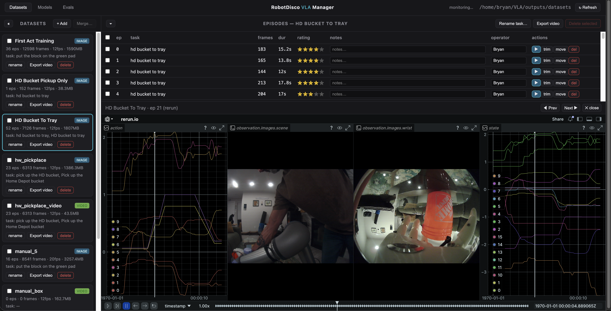
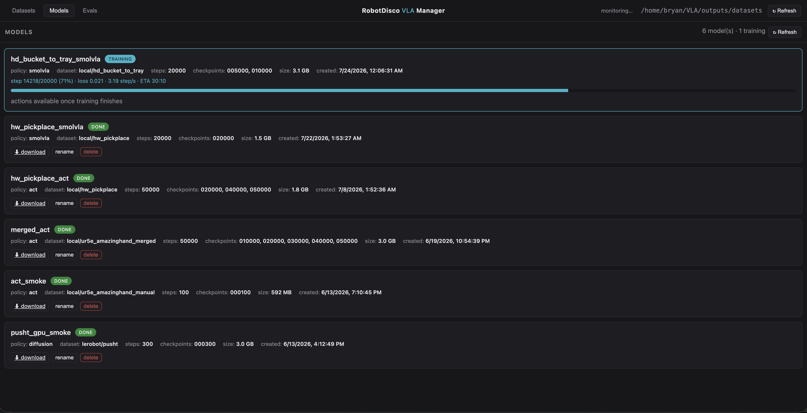

# RobotDisco VLA Manager (`webui/`)

A browser console for the whole loop between recording and deployment, with six tabs — **RobotDisco
Teleop** (the live robot page served by the teleop panel / eval, see below), **Routes** (the robot's
route editor embedded: the nav2 map, the live robot pose and click-to-edit waypoints for `path.py`,
served by `rd_ws/Scripts/route_editor.py` on the robot PC's port 8092; `--route-url` / `VLA_ROUTE_URL`), **Map**
(the same page in map mode: map, robot and both RPLiDAR scans, S1 yellow / S2E green — the start of the
Foxglove-free robot console), **Datasets**
(browse/merge/delete/import, per-episode trim/delete/rate/annotate/rename-task/move, and an episode
player that renders each episode to a static rerun **`.rrd`** shown in rerun's WASM viewer over plain
HTTP), **Models** (every training run + live progress for the one training now), and **Evals** (each
eval run with rating/notes + metrics). The ops delegate to `lerobot.datasets.dataset_tools` and
`lerobot.scripts.lerobot_dataset_viz` (no bespoke dataset surgery except sub-episode trim, which has
no library equivalent). It's self-contained (only needs lerobot + FastAPI), so it runs the same on the
**GPU box**, your **Mac**, or in **Docker**.



## Where it runs
Two copies of the same app:
- **GPU box** (`services/vla_webui.conf`, `http://192.168.11.119:8081/`) — the master: training runs here,
  and `outputs/evals/` here is the registry every eval uploads to.
- **Robot PC** (`services/rd/vla_webui.conf`, `http://192.168.11.80:8081/`, installed by
  `scripts/install_services.sh rd`, autostarts) — the same GUI over the robot's own `outputs/` (its
  datasets, the shipped checkpoints, its eval runs), with the RobotDisco Teleop and Routes tabs on
  loopback. It keeps the manager usable when the GPU box is off or unreachable. Its Train button would
  train on the Orin, which is not what you want — train from the GPU box's copy. Needs `fastapi`,
  `uvicorn[standard]` and `python-multipart` in the robot's venv (in the provisioning pip lists).

## Run it

**Native (GPU box or Mac)** — one-time `uv pip install -r webui/requirements.txt` into the project venv, then:
```bash
HF_HUB_OFFLINE=1 PYTHONPATH=. .venv/bin/python -m webui.server \
  --host 0.0.0.0 --port 8080 --datasets-dir outputs/datasets
# GPU box: browse from the Mac at http://192.168.11.119:8081  ·  Mac: http://localhost:8080
```

**Docker** (multi-arch amd64/arm64; `outputs/datasets` is mounted, not baked in, so edits persist on the host):
```bash
docker compose -f webui/docker-compose.yml up --build       # then http://localhost:8080
# portable image for the x86 GPU/robot infra AND the Mac:
docker buildx build --platform linux/amd64,linux/arm64 -f webui/Dockerfile -t <registry>/vla-webui:0.4.4 --push .
```
The image bundles lerobot + ffmpeg (CPU-only torch). On a **Linux** host uncomment `user: "${UID}:${GID}"`
in the compose service so volume files aren't root-owned; the *import-from-robot-PC* button needs your
SSH key mounted (`~/.ssh:/root/.ssh:ro`).

## Tabs

- **Explorer** — cards per dataset (episodes/frames/fps/size/task/media, the recorded **crop and
  dates** from `meta/capture.json`); check ≥2 → **Merge** (only datasets with the same crop);
  **+ Add** imports a dataset from the robot PC (`rsync` from `rd@.80`) or copies a local path;
  the header polls the folder every 4 s and flags newly-recorded/-changed datasets.
- **Episode manager** — per row: **▶** (play), **trim** (drop a time window), **move** (to another
  dataset), **del**, click-to-set **rating** stars, inline **notes** + **operator**. Rename-task
  applies to the whole dataset or just the selected episodes.
- **Player** — **▶** renders the episode to a rerun `.rrd` (first play of an episode ~30s, then cached)
  and loads it in rerun's WASM viewer over ordinary HTTP — **no gRPC**, so it works in any browser.
  Needs ports **8080** (UI + the `.rrd`) and **9090** (viewer app) reachable; the Docker setup publishes both.
- **Models tab** — lists every run under `outputs/train/` (policy, dataset, steps, checkpoints, size)
  and shows the actively-training one **live** (step/loss/ETA, auto-refreshing); finished models get
  download (zipped checkpoint) / rename / delete. The dataset card's **Train** button fine-tunes SmolVLA
  from `lerobot/smolvla_base` through `scripts/train_regrasp.py` (re-grasp segments oversampled, the
  dataset's crop carried into the run, HF datasets cache pruned); `save_freq` 2500 by default.
- **Evals tab** — runs grouped **by model** (`<run>/<step>`, resolved from the checkpoint the server
  reported) with a combined ★ rating per model; each run card has rating, notes, operator + metrics and
  the rollout video (transcoded to H.264 on demand). `eval_hw.py` pushes every finished run here; manual
  entries and bulk re-assignment to a model are possible. Rename / delete / download per eval.
- **Map tab** — the robot's own pages from the route editor (`rd_ws/Scripts/route_editor.py` on
  the robot PC, port 8092), embedded: **Map** is the 2D map with the robot, the filtered RPLiDAR scans,
  the Velodyne top-down and the costmaps; its **3D** button switches to a three.js scene that replicates Foxglove's 3D panel —
  map, costmaps, Velodyne (coloured by height or intensity), the URDF robot model with live joints, TF
  frames, nav2 plans / goal / footprint / collision polygons / AMCL particles, the route, a follow-robot
  camera, and click tools that publish a nav goal or an initial pose. Both tabs show the camera feeds
  (scene / side / wrist / RealSense) as a strip on the right, click to enlarge. Everything is served from the
  robot (three.js is vendored), so no internet is needed. Links: `http://192.168.11.80:8092/?view=map`
  and `http://192.168.11.80:8092/3d`.
  The Map tab's **live / sim** switch picks which route editor the Map tab shows: the robot's, or
  `route_editor.py --sim`. Choosing sim **starts the simulator on the computer running the manager**
  (port 8094, `--sim-route-url`; the script is found next to this repo or via `--sim-editor`) and
  switching back to live stops it again. Teleop and Routes always talk to the robot. Without the robot: `rd_ws/Scripts/dev_stack.sh start` runs the whole GUI on a laptop — the
  editor in `--sim` (a simulated robot drives a route), the teleop panel with the MuJoCo arm
  (`--engine mujoco --input sliders --ui web`) and this manager with the Map/3D tabs on sim and the
  Teleop tab on the local panel.



## Safety
Rename-task + annotations are in-place; delete/trim/merge/move **rebuild** the dataset and keep the
pre-edit copy as `<name>.bak` (one-click **restore .bak**). Destructive calls require a confirm. `move`
pre-checks fps/feature compatibility *before* touching either side, so a rejected move can't half-apply.
Ratings/notes/operator live in a sidecar (`meta/annotations.json`), outside the LeRobot schema, and are
remapped through the new episode indices on every rebuild.

## RobotDisco Teleop tab (since 2026-10-25)
The teleop panel and the eval serve a browser page from the robot PC (`ur5e_lerobot/ui/webpanel.py`,
port 8090, standard library only, works offline). The manager's first tab embeds that page; while it is
selected the header's right side shows the robot status (`● teleop — <dataset>`) and the page URL
instead of the datasets monitor (`GET /api/robot`, URL from `--robot-url` / `VLA_ROBOT_URL`, default
`http://192.168.11.80:8090/`). The units themselves (`vla_teleop`, `vla_eval`, `vla_infer_server`) are
started and stopped from the robot PC's supervisor web UI at `http://192.168.11.80:9999/`; when nothing
serves the page the tab says so and links there, and it connects by itself once the page is up.
The page also works on its own in any browser — the Mac, a tablet next to the robot, or RD's screen —
and it is the same page in both modes:
- **teleop**: action row (REC / SAVE / DISCARD / HOME / FREEDRIVE / +GRASP, status pills, hold-to-ramp
  open/close, reconnect, hand recover), camera row straight from the camera service, cards for
  exposure, crop (live until the dataset exists), episode, last-saved rating + notes, dataset switch +
  task, arm pose; a fault banner with the decoded UR code and a Recover button; the log.
  Details: [Hardware Teleop & Recording](Hardware-Teleop-and-Recording#browser-page---ui-web-default).
- **eval**: PLAY / FREEDRIVE / RESET / HOME / NEW RUN / open hand / EXIT, model card (checkpoint,
  model key, server flags, crop), run timer and step timing, rating stars, the session's runs.
The Tk window is still there behind `--ui tk` (`--ui both` shows both); `--ui web` (default) hides it.
The **Evals** tab re-reads the registry every 15 s while visible ("live" checkbox), so runs the eval
uploads appear as they finish, and each dataset card has **record cmd**, which copies the exact teleop
launch line that appends to that dataset (same root, storage, task and crop).
