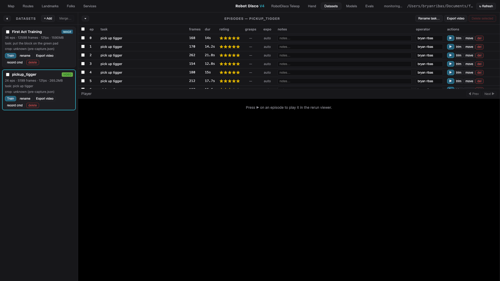
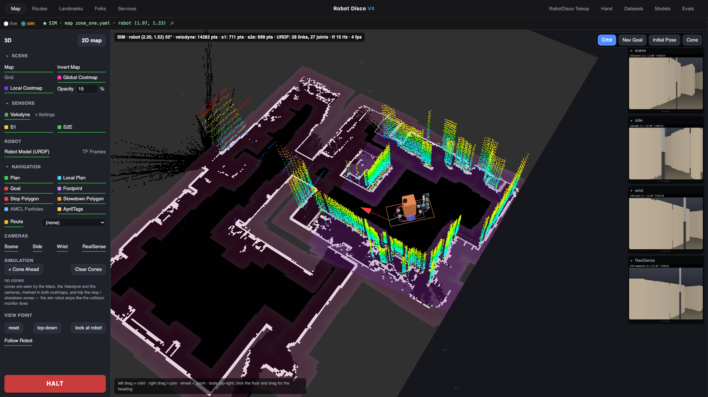
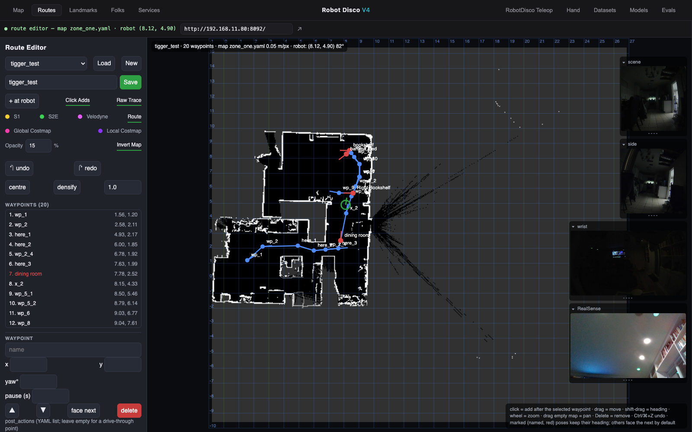
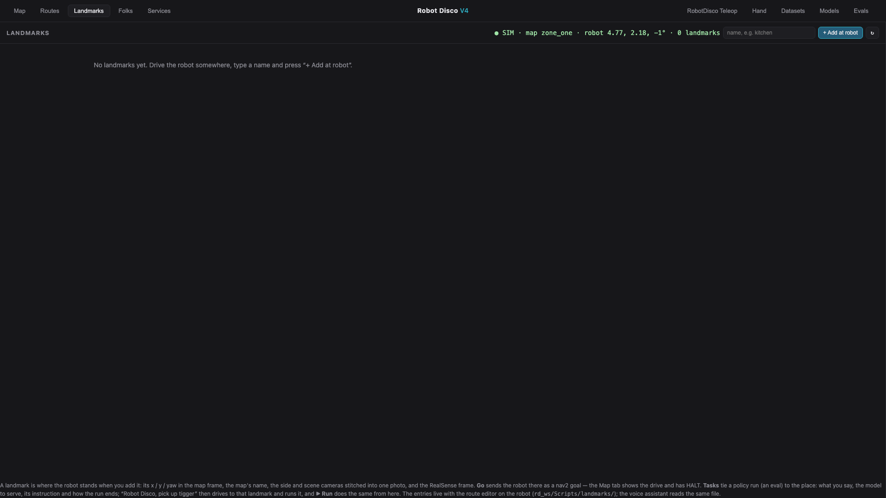
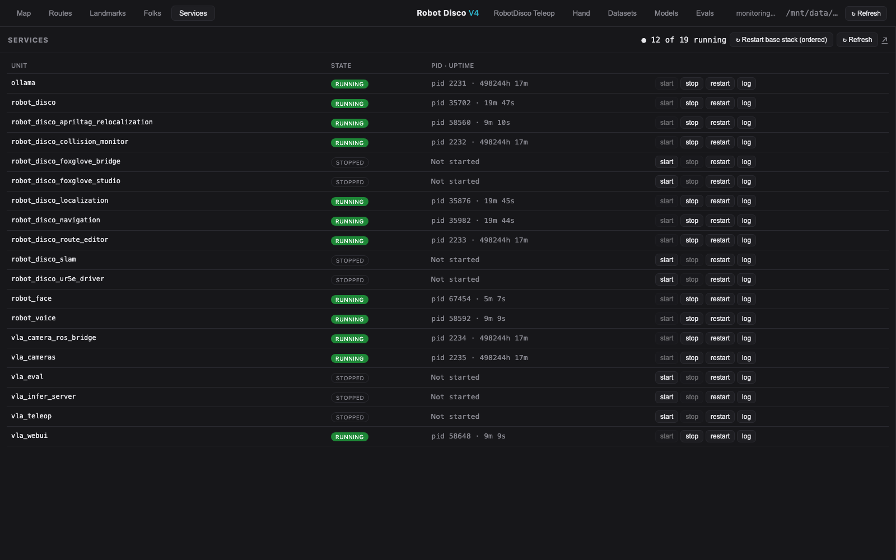
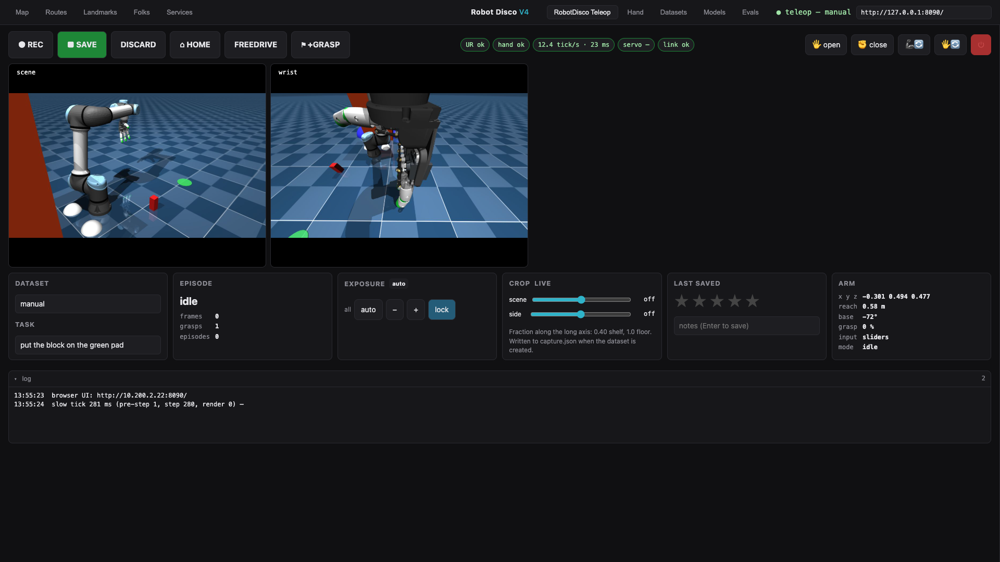

# RobotDisco VLA Manager (`webui/`)

The browser console for the whole robot: the data loop (datasets → training → evals) and the robot
console (map, routes, landmarks, the people it knows, its services, the live teleop/eval page, the
hand). One FastAPI app with a vanilla-JS page, title **Robot Disco V4**, ten tabs in two groups:

| left group | right group |
|---|---|
| **Live** · **Maps** · **Landmarks** · **Routes** · **Folks** · **Services** — the robot (relayed from its own pages and its supervisor) | **VLA Teleop** · **Hand** · **Datasets** · **Models** · **Evals** — the arm and the data |

**Datasets** is the default view; every tab is deep-linkable as `#<view>` (`#map`, `#routes`,
`#landmarks`, `#folks`, `#services`, `#robot`, `#hand`, `#datasets`, `#models`, `#evals`), and the
header's right side shows what the current tab needs (the datasets folder monitor, or the robot page's
status and URL), plus the robot's **speaker volume** on every tab: a mute button and a slider, relayed
through `/api/volume` to the face node's Folks server on the robot (`robot_face` audio_sink), polled every 10 s. The dataset ops delegate to `lerobot.datasets.dataset_tools` and
`lerobot.scripts.lerobot_dataset_viz` (no bespoke dataset surgery except sub-episode trim, which has no
library equivalent). Only lerobot + FastAPI are needed, so the same app runs on the **GPU box**, the
**robot PC**, a **Mac**, or in **Docker**.



## Where it runs
Two copies of the same app, both on port **8081** under supervisor:
- **GPU box** (`services/vla_webui.conf`, `http://192.168.11.119:8081/`) — the master: training runs
  here, and its `outputs/evals/` is the registry every eval uploads to.
- **Robot PC** (`services/rd/vla_webui.conf`, `http://192.168.11.80:8081/`, installed by
  `scripts/install_services.sh rd`, autostarts) — the same GUI over the robot's own `outputs/` (its
  datasets, the shipped checkpoints, its eval runs). The unit passes the LAN URLs of the robot page and
  the route editor (`--robot-url http://192.168.11.80:8090/ --route-url http://192.168.11.80:8092/`) so
  links in the page work from any browser; a loopback URL would be rewritten to the host the browser
  used anyway. It keeps the manager usable when the GPU box is off. Its Train button would train on
  the Orin, which is not what you want — train from the GPU box's copy. Needs `fastapi`,
  `uvicorn[standard]` and `python-multipart` in the robot's venv (in the provisioning pip lists).
- **A laptop without the robot:** `rd_ws/Scripts/dev_stack.sh start` runs the whole GUI — the route
  editor in `--sim` (a simulated robot drives a route, port 8094), the teleop panel with the MuJoCo arm
  (`--engine mujoco --input sliders --ui web`, port 8090) and this manager (port 8081) with the Map tab
  on sim and the Teleop tab on the local panel. `stop` / `status` / `logs` do what they say.

## Run it
**Native** (GPU box, robot PC or Mac) — one-time `uv pip install -r webui/requirements.txt` into the
project venv, then from the repo root:
```bash
HF_HUB_OFFLINE=1 PYTHONPATH=. .venv/bin/python -m webui.server \
  --host 0.0.0.0 --port 8081 --datasets-dir outputs/datasets
```

| CLI flag | env var | default / meaning |
|---|---|---|
| `--host`, `--port` | — | `127.0.0.1`, `8081` (both supervisor units use 8081) |
| `--datasets-dir` | `WEBUI_DATASETS_DIR` | `outputs/datasets` |
| `--repo-root` | `WEBUI_REPO_ROOT` | `.` — where `outputs/train`, `outputs/evals`, `scripts/` are |
| `--web-port` | — | `9090`, the rerun viewer app |
| `--robot-url` | `VLA_ROBOT_URL` | `http://192.168.11.80:8090/`, the robot page (Teleop tab) |
| `--route-url` | `VLA_ROUTE_URL` | `http://192.168.11.80:8092/`, the robot's route editor (Routes, Map live, Landmarks) |
| `--sim-route-url` | `VLA_SIM_ROUTE_URL` | `http://127.0.0.1:8094/`, the simulated editor (never the live editor's 8092) |
| `--map-source live\|sim` | `VLA_MAP_SOURCE` | `live` |
| `--sim-editor` | `VLA_SIM_EDITOR` | path of `route_editor.py`; default: `../Scripts/route_editor.py` (this repo is the `rd_ws/VLA` submodule), then `~/rd_ws/Scripts/route_editor.py` |
| `--supervisor-url` | `VLA_SUPERVISOR_URL` | `http://192.168.11.80:9999/RPC2`, the robot's supervisor (Services tab) |
| `--hand-host` | `VLA_HAND_HOST` | `192.168.11.117`, the hand's ESP32 (Hand tab) |
| — | `VLA_HAND_UDP_PORT` | `8766` |
| — | `VLA_FOLKS_URL` | `http://192.168.11.80:8096/`, robot_face's Folks page (env only, no CLI flag) |

**Docker** (multi-arch amd64/arm64; `outputs/datasets` is mounted, not baked in, so edits persist on the host):
```bash
docker compose -f webui/docker-compose.yml up --build       # then http://localhost:8080
docker buildx build --platform linux/amd64,linux/arm64 -f webui/Dockerfile -t <registry>/vla-webui:0.4.4 --push .
```
The image bundles lerobot + ffmpeg (CPU-only torch). On a **Linux** host uncomment `user: "${UID}:${GID}"`
in the compose service so volume files aren't root-owned; the *import-from-robot-PC* button needs your
SSH key mounted (`~/.ssh:/root/.ssh:ro`). The image only copies `webui/`, so two tabs are reduced in
Docker: the **Hand** tab's presets and sliders import `ur5e_lerobot.hand` (raw lines still work), and
the Map tab's **sim** switch needs `rd_ws/Scripts/route_editor.py`. Use the native app for those.

## The data tabs

### Datasets
- **Explorer** (collapsible, `«`) — a card per dataset: episodes / frames / fps / size / task / media
  (IMAGE or VIDEO), the recorded **crop and dates** from `meta/capture.json`. Buttons: **Train**,
  **rename**, **Export video** (`to_video`, image datasets to MP4), **record cmd** (copies the exact
  teleop launch line that appends to this dataset: same root, storage, task and crop), **restore .bak**
  when a backup exists, **delete**. Check ≥2 cards → **Merge…**; **+ Add** imports a dataset from the
  robot PC (`rsync` from `rd@192.168.11.80:~/rd_ws/VLA/outputs/datasets/<name>`) or copies a local path.
  The header's monitor polls the folder every 4 s and flags newly recorded or changed datasets.
- **Episode table** — columns: select, ep, task, frames, dur, **rating** (click-to-set stars), **grasps**
  (re-grasp marks the panel recorded), **expo** (the exposure locked at launch), **notes**, **operator**,
  actions **▶** / **trim** (drop a time window) / **move** (to another dataset) / **del**. Toolbar:
  **Rename task…** (whole dataset or just the selected episodes), **Export video**, **Delete selected**.
  grasps and expo are read-only; they come from `meta/annotations.json`.
- **Player** — **▶** renders the episode to a rerun `.rrd` (first play ~30 s, then cached) and loads it
  in rerun's WASM viewer over plain HTTP, no gRPC. **◀ Prev / Next ▶** (also ←/→) step through the
  episodes, ✕ closes. Needs the UI port and **9090** (`--web-port`) reachable; Docker publishes both.
- **Merge does not check or carry `meta/capture.json`**: a merged dataset shows "crop: unknown" until
  `scripts/capture_backfill.py --root <merged> --scene <at> --side <at>` writes one (done for
  `tigger_1_merged` on 2026-10-26). Only merge datasets recorded with the same crop.

### Models
Lists every run under `outputs/train/` (policy, dataset, steps, checkpoints, size, created, a status
badge) and shows the one **training now** live: step / loss / rate / ETA, refreshed every 5 s (only the
box that is training sees this). Finished runs: **⬇ download** (zipped checkpoint, `?step=` picks one),
**rename**, **delete**.


**Train** (the dataset card's button) opens a dialog: **SmolVLA fine-tune** (default) or **ACT from
scratch**, steps, batch size, `save_freq` (2500). SmolVLA runs `scripts/train_regrasp.py
--policy.path=lerobot/smolvla_base` with a `--rename_map` built from the dataset's image keys
(scene / wrist / side → camera1/2/3, what `smolvla_base` was trained on) and a **re-grasp weight chosen
from the dataset's own recovery share**: 3 below 10 %, 2 below 20 %, else 1 (no oversampling). It copies
the dataset's `capture.json` into the run and prunes the HF datasets cache afterwards. Every run uses
`--num_workers=4` (8 took the GPU box down on 2026-09-24) and is launched under
`systemd-run --user` with `MemoryMax=40G`, `MemorySwapMax=4G`, `OOMPolicy=stop`, so a dataloader
blow-up kills that run and nothing else; without a user bus (a supervisor-spawned manager) it falls back
to a plain detached process.

### Evals
Runs grouped **by model** (`<run>/<step>`, resolved from the checkpoint the inference server
reported), each group with its combined ★, runs / rated, success % and the number of inferred
checkpoints, collapsible. A run card has an editable **checkpoint** field (tagged *inferred* when the
registry had to guess it from the serve symlink), server, task, **at: ⌖ <landmark>** (runs started
from a landmark task), steps, duration, fps, n-act, exposure, date, stars, notes, operator, a source
badge (auto from `eval_hw.py`, or manual), **▶ video** (the rollout, transcoded to H.264 on demand),
download, rename, delete. The unassigned group has **assign model to all…**. Header: **+ New eval**
(a manual entry: name, model, task, episodes, successes, operator, notes), refresh, and **live**
(re-reads the registry every 15 s while the tab is open, so runs appear as the eval uploads them).

## The robot tabs

### Live
The robot's own pages from the route editor (`rd_ws/Scripts/route_editor.py` on the robot PC, port
8092), embedded. It opens the **3D view** (`/3d`) by default — a three.js scene: map, costmaps, the
Velodyne cloud (coloured by height or intensity), the URDF robot with live joints, TF frames, nav2
plans / goal / footprint / stop and slowdown polygons / AMCL particles / AprilTags, the route, cameras,
a follow-robot camera and click tools that publish a nav goal or an initial pose. Its **2D map** button
switches to the 2D page (`?view=map`: map, robot, the filtered RPLiDAR scans, the Velodyne top-down,
the costmaps, the same nav-goal / initial-pose tools). Both pages show the camera feeds (scene / side /
wrist / RealSense) as a strip on the right, click to enlarge, and have **HALT**. Everything is served
from the robot (three.js vendored), no internet needed. Direct links: `http://192.168.11.80:8092/3d`
and `http://192.168.11.80:8092/?view=map`.

The header's **live / sim** switch picks which editor the tab shows: the robot's, or
`route_editor.py --sim`. Choosing sim **starts the simulator on the computer running the manager**
(port 8094, log `log/sim_editor.log`; the script is found via `--sim-editor`, else one level up in
`rd_ws/Scripts`) and switching back to live stops it. The status line shows the map and the robot
pose, ↗ opens the page on its own. Teleop and Routes always talk to the robot.



### Maps

The robot's nav maps: every `<name>.yaml` + image in `rd_ws/src/robot_disco/maps` on the robot, listed with a
thumbnail, size, resolution and whether it was made with SLAM (its posegraph is kept). One map is **active**:
localization loads it (`maps/active_map`), the Live tab shows it, and new routes and landmarks are tagged
with it — routes, landmarks and their tasks belong to the map they were made on, and the route editor and
the Landmarks tab show which.

- **Activate** — makes a map the robot's: the editor serves it and the localization + navigation units
  restart on it (set the initial pose afterwards).
- **+ New map (SLAM)** — type a name: localization stops and `robot_disco_slam` (slam_toolbox) starts on a
  fresh map. Drive the robot around with the gamepad or VLA Teleop; the Live tab shows the map grow. **Save**
  writes the image, the yaml and the posegraph through slam_toolbox's services; **Stop mapping** stops the
  unit and brings the file map back; then Activate the new map.
- **Edit via SLAM** — the same, continuing from a map's posegraph (only maps made with SLAM have one).
- **✎ Edit** — a drawing editor over the map image: paint walls (black), free space (white) or unknown
  (grey) with a brush, a line or a filled rectangle; wheel to zoom, pan tool or shift-drag to pan, undo /
  redo; save over the map or as a new one.
- **Delete** — removes the map's files (not the active map).

The manager relays all of it to the route editor (`/api/maps` there) and drives the units through
supervisor, so it works from any machine; with the Live tab's switch on sim only the editor is involved.

### Routes
The robot's route editor itself (always live), with a URL box and ↗: the nav2 map, the live robot pose,
click-to-edit waypoints with their `post_actions` (including `vla:` policy runs), Load / New / Save for
`rd_ws/Scripts/path.py` routes, undo / redo, centre / densify. Details in the rd_ws README.


### Landmarks
Named places the robot can navigate to, kept by the route editor on the robot
(`rd_ws/Scripts/landmarks/landmarks.yaml` + photos in `img/`, API `/api/landmarks*`; the manager
relays and follows the Map tab's live / sim switch). The status line shows the map, the robot pose, the
landmark count and whether the voice assistant listens. **+ Add at robot** saves where the robot
stands: x / y / yaw in the map frame, the map's name, the side and scene cameras stitched into one
photo and the RealSense frame. Each card shows a 4 m map window around the landmark with its heading,
the two photos (click for full size), and has **Go** (a nav2 `/goal_pose` through the editor's
publisher; disabled when the landmark belongs to another map), **Rename…**, **↻ Photos**, **⌖ Update**
(pose and photos from the current position) and **Delete**.

Each card also lists the landmark's **Tasks** (+ Task, ✎, ×, ▶ Run): a policy run tied to the place —
what you say ("pick up tigger"), the training run to serve, the policy's task string and the
`vla_action.py` end conditions (max seconds, stillness, hand closed / opened, keep the grasp, return
home, extra args; the API also accepts `min_seconds` and `still_mode`, which the dialog does not show
yet). The robot's voice assistant reads the same file: "Robot Disco, pick up tigger" drives to the
landmark (Nav2) and runs the policy, speaking at each step; **▶ Run** does the same from the browser
(the editor publishes the job on `/robot_voice/run_task`; enabled when `robot_voice` listens, and in
sim). Runs record the landmark on their `eval.json` (`--landmark`), shown on the Evals tab.



The Live tab also has a collapsible **Activity** pane along its bottom edge (state remembered in the browser): the
supervisor log tails of the nav, collision monitor, localization, route editor, voice, face, eval and inference units, merged by
time (`/api/activity`), with the chatter filtered out and repeats folded into `×N`. Chips switch units, a level selector and
**waiting / problems only** narrow it to the lines about stopping, failing, recovering; the summary names any unit that is down.
It is only fetched (every 3 s) while the pane is open and the Live tab is showing.

### Folks
robot_face's Folks page from the robot (port 8096, `VLA_FOLKS_URL`), embedded: a card per known
person with their face picture, an editable name, first / last seen, how often recognised, last hello
with a reset, snap, Forget, and a live "in view" badge. The status line shows the known count and who
is in view. Needs `robot_face` running with its camera.
<!-- No screenshot on purpose: the tab shows people's faces and names. -->

### Services
The robot's supervisor units (`/api/services`, via supervisor's XML-RPC at `--supervisor-url`): a
table with state, pid · uptime, **start / stop / restart** per unit and a **log** tail (stdout or
stderr, `/api/services/<name>/log?stream=&lines=`), refreshed every 4 s while no log is open; ↗ opens
the supervisor web UI (`:9999`). This is where `vla_teleop`, `vla_eval`, `vla_infer_server` and the
rest are switched on and off from a browser. **↻ Restart base stack (ordered)** restarts
`robot_disco` (settle 25 s) → `robot_disco_localization` (8 s) → `robot_disco_navigation` (5 s) →
`robot_disco_collision_monitor` (3 s) → `robot_disco_route_editor`, the order that keeps every node
bound to live publishers, with job progress in the tab. The robot must be stationary.


### VLA Teleop
The robot page served by the teleop panel or the eval (`ur5e_lerobot/ui/webpanel.py`, port 8090,
standard library only), embedded; while the tab is selected the header shows `● <mode> — <title>` and
the page URL (`GET /api/robot`, URL from `--robot-url`). When nothing serves the page the tab says
so, points at the Services tab and the supervisor UI, and connects by itself once the page is up. The
page also works on its own in any browser, and it is the same page in both modes:
- **teleop**: ● REC, ■ SAVE, DISCARD, ⌂ HOME, FREEDRIVE, ⚑ +GRASP; status pills (UR / hand / tick /
  servo / link); hold-to-ramp **🖐 open** / **✊ close**; **🦾🔄** (reconnect the UR), **🖐🔄** (recover
  the hand), **⏻ quit**; the camera row straight from the camera service; cards for Dataset + Task,
  Episode, Exposure, Crop (live until the dataset exists), Last saved (★ + notes), Arm; a fault banner
  with the decoded UR code and a **Recover** button; the log.
  Details: [Hardware Teleop & Recording](Hardware-Teleop-and-Recording#browser-page---ui-web-default).
- **eval**: ▶ PLAY, FREEDRIVE, RESET, ⌂ HOME, NEW RUN, 🖐 open, ✊ close, EXIT; cards for Exposure,
  Model (checkpoint, model key, server flags, crop), Run (timer, step timing, stars), Runs this session,
  Arm. Details: [Deploy on Hardware](Deploy-on-Hardware).


<!-- TODO screenshot: robot-page-eval.png — http://192.168.11.80:8090/ with vla_eval running (robot only, not yet captured) -->

### Hand
Drives the AmazingHand directly, without the teleop panel. The panel head shows the liveness probe
(alive, uptime, sent / failed), the host box (stored per browser in localStorage; default `--hand-host`
/ `VLA_HAND_HOST`, 192.168.11.117), a **probe** button and the ↗ WebSerial console. Below: six
**presets** (open / half / close / point / pinch / thumb up), a **sliders** grid — an "all" row, then
thumb / index / middle / pinky with **curl** and **abduction**, streaming while dragged and labelled by
*physical* finger (this hand's curl channels 0-3 move the middle, pinky, index and thumb, not the
"index, middle, ring, thumb" the schema names them; the teleop's Stream Deck keys carry the same
remap) — **speed** (50-2000), the firmware's 12 **gestures** (one character each) and a **raw line**
box with its reply (`Q` → `K:<uptime>`). Each command is one UDP datagram to the hand's port 8766, the
way the teleop and eval streams send theirs — nothing holds a session, so a running teleop or eval
simply overrides what the tab sent.
<!-- TODO screenshot: manager-hand.png — http://192.168.11.119:8081/#hand with the hand powered (robot network only, not yet captured; manager-hand-offline.png shows the layout with the hand unreachable) -->

## Safety
Rename-task + annotations are in-place; delete / trim / merge / move **rebuild** the dataset and keep
the pre-edit copy as `<name>.bak` (one-click **restore .bak**). Destructive calls require a confirm.
`move` pre-checks fps / feature compatibility *before* touching either side, so a rejected move can't
half-apply. Ratings / notes / operator / grasps / exposure live in a sidecar (`meta/annotations.json`),
outside the LeRobot schema, and are remapped through the new episode indices on every rebuild.
